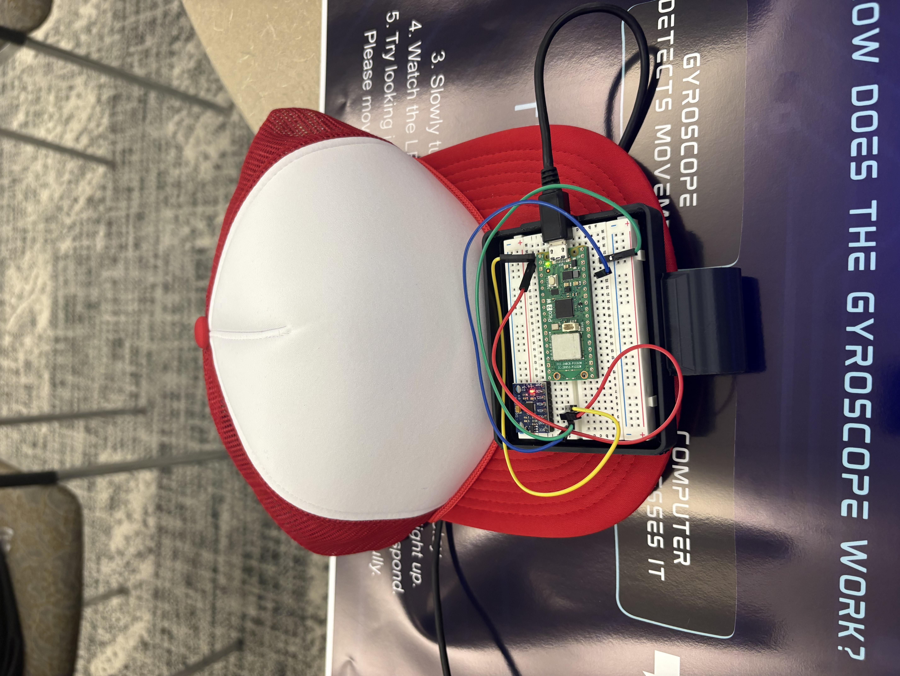

**VR Head-Tracking Exhibit**

**Description**

The VR Head-Tracking Exhibit is an interactive educational project that demonstrates how virtual reality head tracking works.

A gyroscope mounted in a 3D-printed head piece detects the user’s head movement. A Raspberry Pi Pico processes the sensor data and sends it wirelessly to a SparkFun RedBoard. The RedBoard controls a continuous strip of 66 individually addressable LEDs.

When the user looks forward, LEDs near the center illuminate. Turning left or right causes LEDs toward that side of the strip to light up, making the normally hidden process of VR head tracking visible.

**Components**

Raspberry Pi Pico

SparkFun RedBoard

Gyroscope sensor

66-LED addressable strip

3D-printed head piece

Bluetooth / wireless communication hardware

Breadboard

Jumper wires

Resistors

Power bank

Batteries

